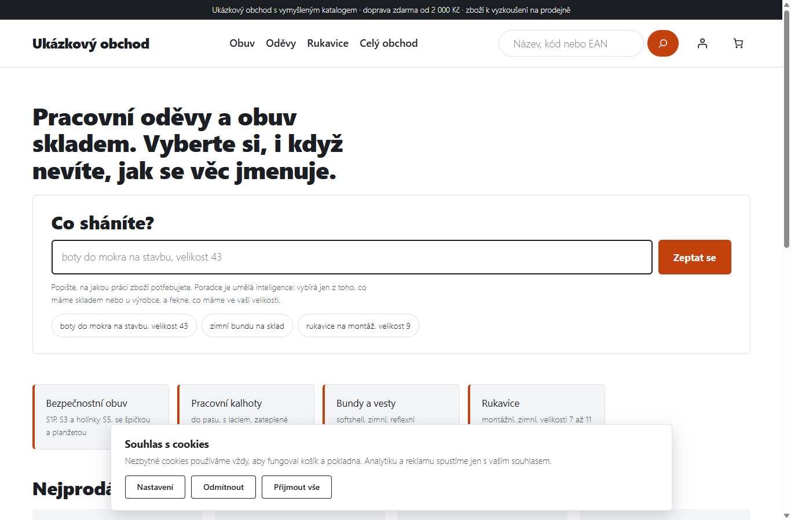
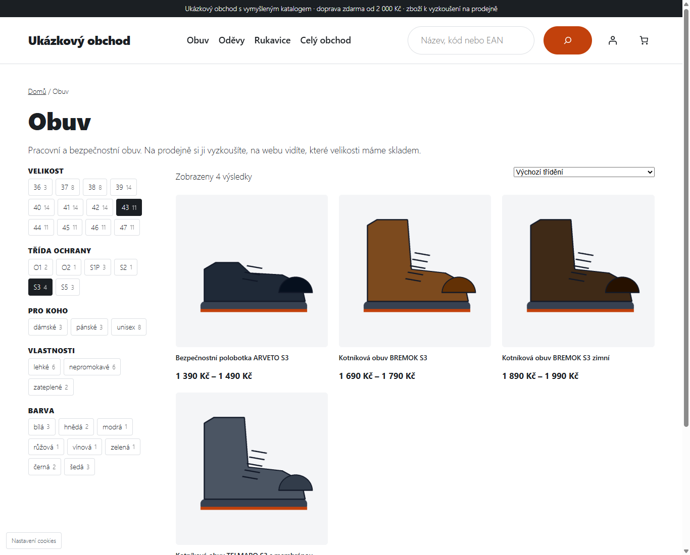
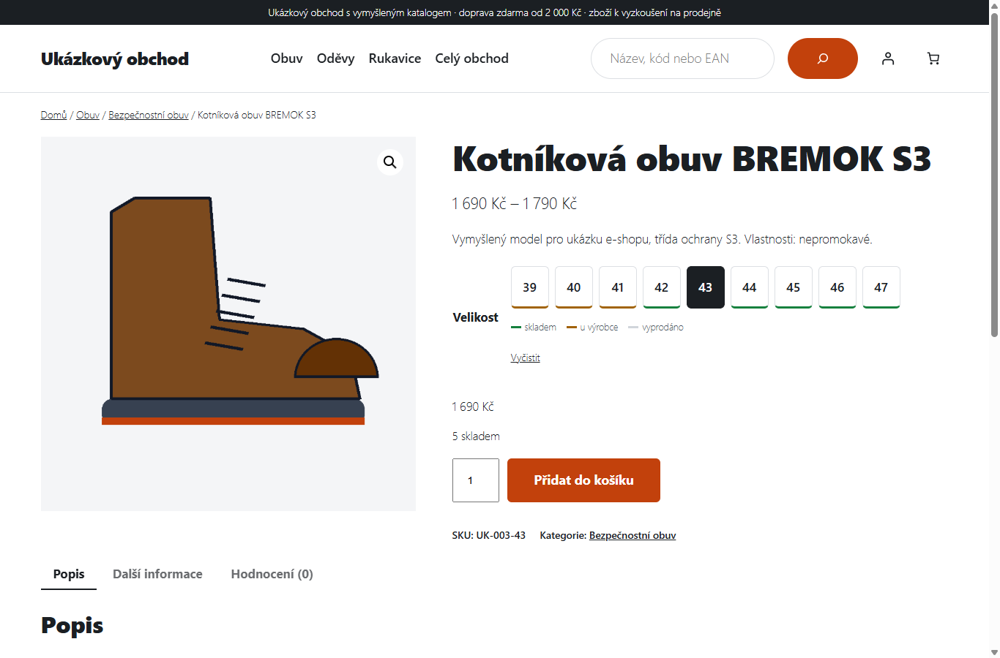
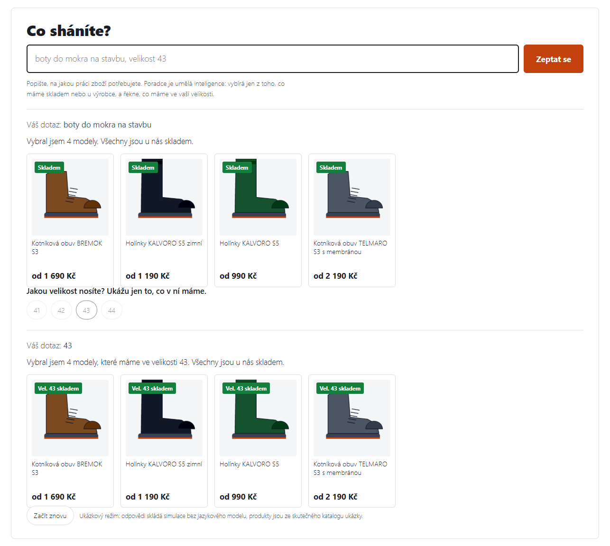
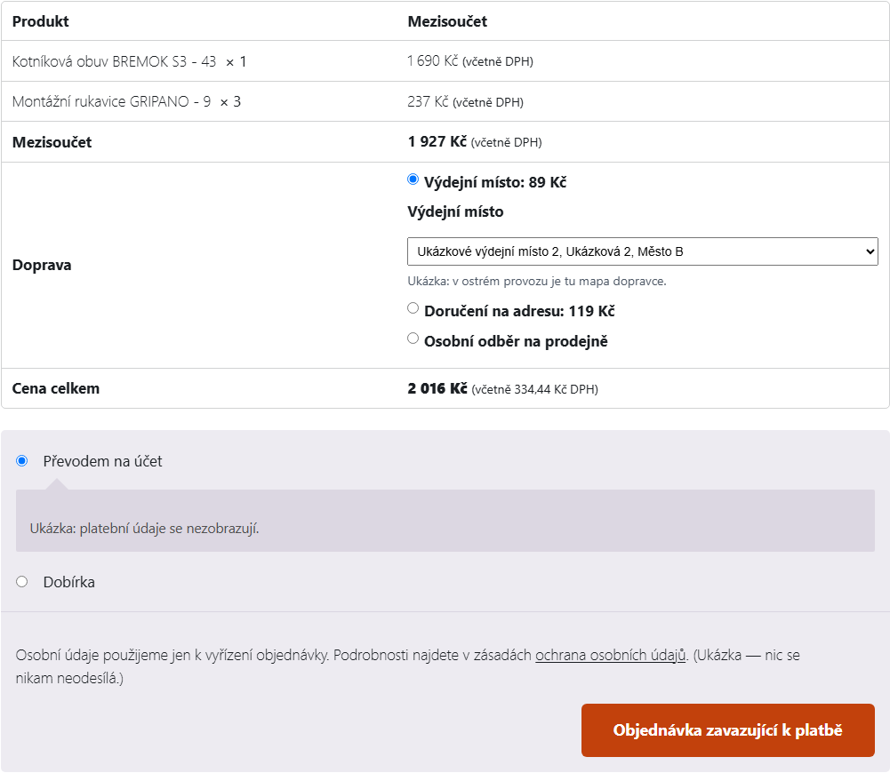
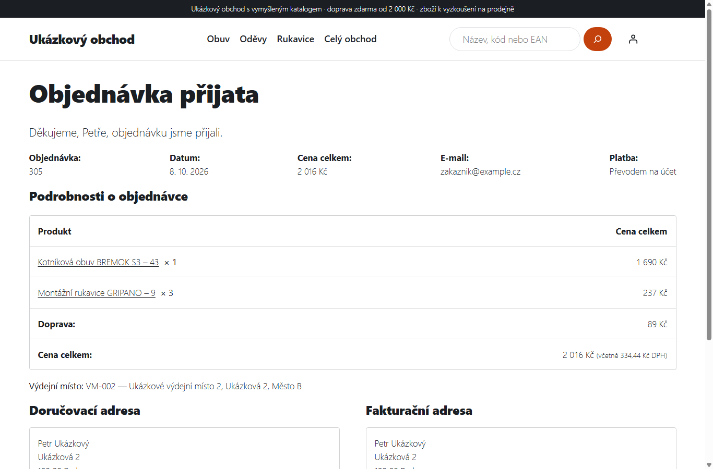
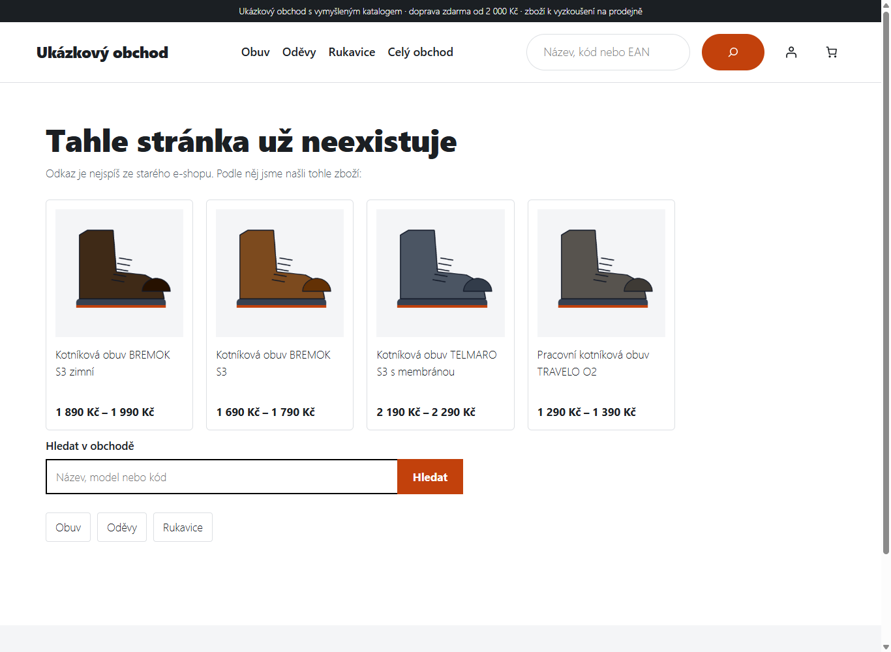
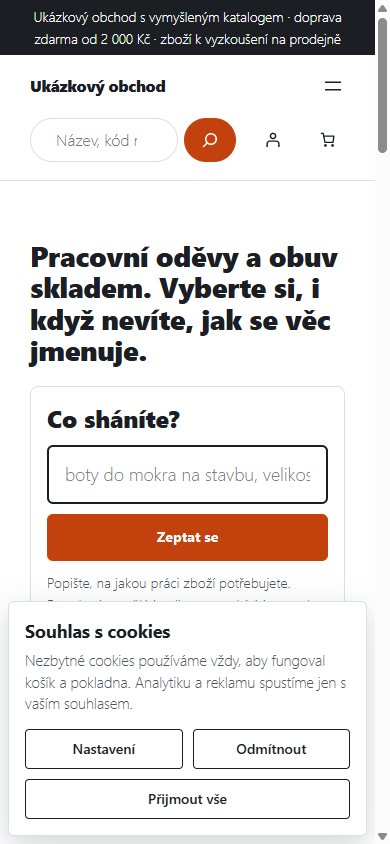
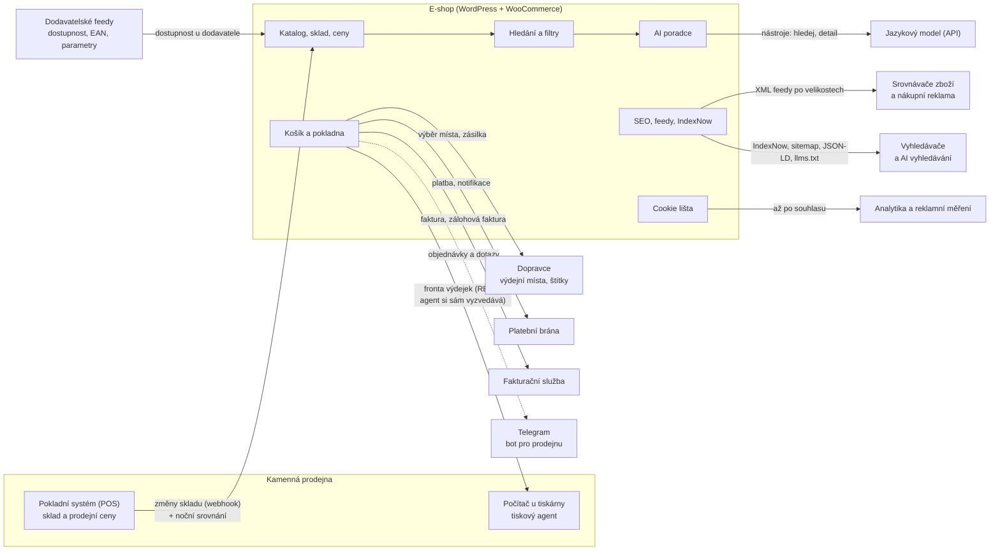
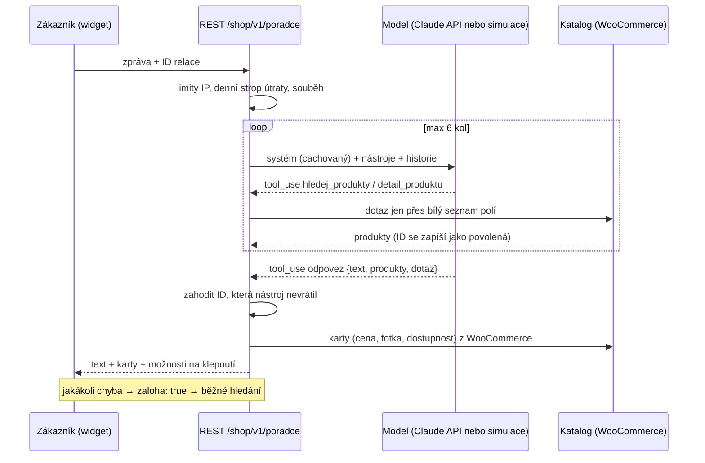

# woocommerce-store-showcase

**E-shop s pracovními oděvy a obuví na WooCommerce, který prodává za prodejnu i po zavírací době — napojený na pokladnu, sklad, dopravce, platby, fakturaci, srovnávače a AI poradce.**

[English version below](#english)

<!-- Odkaz začne fungovat po zveřejnění repa (Playground si blueprint stáhne z GitHubu). -->
[▶ Vyzkoušet ukázku v prohlížeči](https://playground.wordpress.net/?blueprint-url=https://raw.githubusercontent.com/jaravelin-dot/woocommerce-store-showcase/main/blueprint.json) — WordPress běží přímo v prohlížeči, nic se neinstaluje.



## Pro majitele firem

### Problém

Kamenná prodejna s tisíci položek v desítkách velikostí potřebuje e-shop, který nebude „druhý
sklad na údržbu". Krabicová řešení neznají pokladnu na prodejně, neumí velikosti jako samostatné
skladové položky, nehlídají, aby se na web nedostala nákupní cena, a zákazník, který neví, jak se
věc jmenuje, odejde s prázdnou.

### Řešení

E-shop na WordPressu a WooCommerce, kde **košík, pokladnu a daně nechává na WooCommerce** a všechno
okolo je napsané na míru: napojení, sklad, hledání, SEO, provoz.

- **Sklad a ceny se berou z pokladního systému prodejny.** Jeden sklad pro prodejnu i web, ceny
  s DPH vždy na celé koruny, nákupní ceny se na web nedostanou (hlídá to i automatická pojistka).
- **AI poradce.** Zákazník napíše „boty do mokra na stavbu, velikost 43" a dostane modely, které
  ve 43 skladem opravdu jsou. Poradce smí ukázat jen zboží, které mu vrátil katalog, má denní strop
  útraty a při jakémkoli výpadku tiše přepne na běžné hledání.
- **Hledání a filtry, které znají velikosti.** Filtr ukáže jen velikosti, které v kategorii jsou;
  kód zboží nebo EAN z krabice vede rovnou na produkt.
- **Doprava, platby a doklady.** Výdejní místa, osobní odběr, doprava zdarma od částky, zálohová
  faktura s QR platbou, e-maily s oslovením v 5. pádě („Dobrý den, Petře,").
- **Výdejka vyjede na prodejně sama.** Po zaplacení objednávky se na tiskárně v prodejně vytiskne
  výdejka s fotkou a čárovými kódy — i když je server v datacentru a počítač byl přes noc vypnutý.
- **Marketing a SEO od prvního dne.** Feedy pro srovnávače a nákupní reklamu po velikostech,
  strukturovaná data, `llms.txt` pro AI vyhledávače, okamžité ohlašování změn vyhledávačům,
  chytrá chybová stránka, která ze starého odkazu najde správné zboží.
- **Cookie lišta podle pravidel.** Tři kategorie, odmítnutí stejně snadné jako souhlas, měření
  konverzí až po souhlasu.

### Přínos

- Zboží, ceny a sklad se nepřepisují ručně na dvou místech — co se prodá na prodejně, zmizí z webu.
- Zákazník najde i to, co neumí pojmenovat; poradce nikdy nenabídne zboží, které neexistuje.
- Objednávka z webu je za pár minut na papíře ve skladu, bez kontroly e-mailu.
- Přechod ze starého e-shopu bez ztráty návštěvnosti: přesměrování starých adres a chytrá 404.

### Z reálného provozu

Nasazeno v reálném provozu v maloobchodu s pracovními oděvy: **tisíce produktů, desítky tisíc
variant (velikostí), přes sto kategorií, 104 automatických testů.** E-shop je
součástí širší automatizace (2 firmy, desítky automatických úloh denně).

Toto repo je výběr modulů přepsaných pro veřejnou ukázku a spustitelné demo nad **vymyšleným
katalogem**. Všechny produkty, kódy, ceny a adresy jsou smyšlené, služby třetích stran
(pokladní systém, dopravce, platební brána, fakturace, AI) jsou v ukázce vypnuté nebo simulované.

**Chcete něco podobného pro svůj obchod?** Napište mi: Jaroslav Velek, [jaravelin@gmail.com](mailto:jaravelin@gmail.com)

### Ukázka v obrázcích

Snímky jsou z lokálně spuštěné ukázky (`npm run demo`) nad vymyšleným katalogem.

| | |
|---|---|
|  **Kategorie s filtry** — nabízí jen velikosti a třídy, které v kategorii jsou |  **Detail produktu** — velikosti jako tlačítka se stavem skladu |
|  **AI poradce** — doplňující otázka na klepnutí a karty jen ze skutečného katalogu |  **Pokladna** — výdejní místo pod sazbou dopravy, ceny na celé koruny |
|  **Po objednávce** — oslovení v 5. pádě |  **Chytrá 404** — ze staré adresy najde odpovídající zboží |

 **Mobil** — sbalená cookie lišta nezakryje nabídku, odmítnutí je stejně velké tlačítko jako souhlas.

---

## Mapa funkcí

Modul v tomto repu je u funkce uvedený cestou; ostatní funkce jsou v ostrém nasazení, tady jen popsané.

| Oblast | Co e-shop umí | V repu |
|---|---|---|
| **Sklad a ceny** | Sklad sdílený s prodejnou (příjem změn z pokladního systému webhookem, noční srovnání), velikosti jako samostatné varianty s EAN, cena s DPH vždy na celé koruny i v košíku s více kusy, cena s i bez DPH se sazbou, zboží „jen na prodejně" a „připravujeme", dostupnost u dodavatele | [ceny na celé koruny](wp-content/plugins/shop-showcase/includes/class-shop-cena-cele-koruny.php) |
| **Hledání** | Fulltext s překlepy a našeptávačem, hledání podle kódu a EAN (i varianty → předvybraná velikost), hledání podle vlastností, filtry jen s hodnotami, které v kategorii jsou | [kód/EAN](wp-content/plugins/shop-showcase/includes/class-shop-hledani.php), [filtry](wp-content/plugins/shop-showcase/includes/class-shop-filtry.php) |
| **AI poradce** | Rozhovor nad katalogem s nástroji (hledání, detail), karty produktů z WooCommerce, doplňující otázky na klepnutí, denní strop útraty, limity na IP, log dotazů, záloha na běžné hledání | [poradce](wp-content/plugins/shop-showcase/includes/class-shop-poradce.php), [nástroje](wp-content/plugins/shop-showcase/includes/class-shop-poradce-katalog.php), [prompt](wp-content/plugins/shop-showcase/includes/class-shop-poradce-prompt.php), [model + simulace](wp-content/plugins/shop-showcase/includes/class-shop-poradce-model.php), [widget JS](wp-content/plugins/shop-showcase/assets/js/poradce.js) |
| **Pokladna a doprava** | Výdejní místa dopravce v pokladně, osobní odběr bez vyplňování adresy, doprava zdarma od částky, vazba doprava → platba, platební brána, zálohová faktura s QR platbou po neúspěšné platbě | [výdejní místa (statická ukázka)](wp-content/plugins/shop-showcase/includes/class-shop-vydejni-mista.php) |
| **Doklady a e-maily** | Faktury ve fakturační službě, vlastní předměty a texty e-mailů, „Připraveno k vyzvednutí", oslovení jménem v 5. pádě, formuláře reklamace a vrácení | [oslovení](wp-content/plugins/shop-showcase/includes/class-shop-osloveni.php), [slovník jmen](wp-content/plugins/shop-showcase/includes/data/osloveni-jmena.php) |
| **Tisk výdejek** | Fronta tiskových úloh, REST pro agenta na prodejně, výdejka s fotkou a čárovým kódem EAN-13, dotisk z administrace, upozornění při poruše | [fronta + výdejka](wp-content/plugins/shop-showcase/includes/class-shop-tisk.php), [EAN-13 SVG](wp-content/plugins/shop-showcase/includes/class-shop-ean13.php), [agent (Python)](tisk-agent/) |
| **Marketing a SEO** | Meta popisky, Open Graph, kanonické adresy, noindex/nofollow filtrů, robots.txt, JSON-LD (firma, prodejna, ProductGroup s velikostmi), `llms.txt`, feedy po velikostech, IndexNow, chytrá 404, přesměrování starého e-shopu, hodnocení a ověřené recenze | [SEO](wp-content/mu-plugins/shop-seo/), [feedy](wp-content/mu-plugins/shop-feedy/), [IndexNow](wp-content/mu-plugins/shop-indexnow.php), [chytrá 404](wp-content/mu-plugins/shop-chyba-404.php) |
| **Cookie lišta a konverze** | Tři kategorie souhlasu, odmítnutí rovnocenné souhlasu, signály souhlasu pro reklamní systémy, konverze a nákup v analytice až po souhlasu, bez osobních údajů | [cookie lišta](wp-content/mu-plugins/shop-cookie-souhlas/), [konverze](wp-content/mu-plugins/shop-cookie-souhlas/class-shop-konverze.php) |
| **Zákaznické funkce** | Účet s registrací jen e-mailem (ochrana bez captchy), oblíbené produkty, hromadné přidání velikostí do košíku, dotaz k zboží „na objednávku", stálá sleva převedených zákazníků | [ochrana registrace](wp-content/plugins/shop-showcase/includes/class-shop-registrace-ochrana.php) |
| **Provoz a bezpečnost** | Náhledy obrázků ve WebP, cache, mu-pluginy pro kritické vrstvy, hook proti úniku nákupních cen a klíčů při práci s AI asistentem, testy | [bezpečnostní hook](tools/bezpecnostni-hook/) |

## Napojení



---

## Technická část

### Architektura

- **WooCommerce zůstává jádrem.** Košík, pokladna, DPH a stavy objednávek se nepřepisují; vše ostatní
  jsou háky a vlastní třídy. Objednávky přes HPOS (`wc_get_order()`), SQL jen přes `$wpdb->prepare()`.
- **Kritické vrstvy jako mu-pluginy** (SEO, feedy, cookie lišta, IndexNow, 404): načtou se vždy, bez
  aktivace, a nezmizí s výměnou šablony.
- **Funkce obchodu jako plugin** `shop-showcase` (ve skutečném nasazení 48 tříd).
- **Šablona** je bloková child šablona Twenty Twenty-Five (`wp-content/themes/shop-demo`).
- **Dlouhé operace** (feedy, import, synchronizace) přes WP-Cron / WP-CLI, nikdy v HTTP požadavku.
- **Externí služby za tenkým klientem** přes `wp_remote_*` s timeouty, pojistkou po sérii chyb
  a záložním chováním (poradce → hledání, fulltext → hledání WordPressu, 404 → kategorie).

### AI poradce podrobněji



- Model **nesmí ukázat produkt, který mu nevrátil nástroj** — jiná ID se vyhodí a zalogují.
- Cena, fotka a dostupnost na kartě jsou vždy z WooCommerce, nikdy z textu modelu.
- Filtr bez shody se nezahazuje tiše (z „S3" by bylo „cokoli"), nástroj vrátí 0 a poznámku.
- Denní strop útraty v USD se sčítá z logu (atomický INSERT), ne z jedné volby.
- Systémový prompt je bajtově stabilní kvůli prompt cachingu; slovník katalogu je setříděný.
- **Simulace** (`Shop_Poradce_Simulace`) prochází stejnou smyčkou bez API klíče: deterministický
  rozbor dotazu → stejné nástroje → odpověď ze šablony. S vlastním klíčem jde v administraci
  (WooCommerce → Poradce) přepnout na Claude (`claude-opus-5-5`, záložní model při odmítnutí).

### Struktura repa

```
wp-content/
  mu-plugins/
    shop-seo.php, shop-seo/          meta, Open Graph, kanonické, robots, JSON-LD, llms.txt
    shop-feedy.php, shop-feedy/      XML feedy po velikostech (srovnávač, nákupní reklama)
    shop-cookie-souhlas.php, …/      cookie lišta (3 kategorie) + konverze po souhlasu
    shop-indexnow.php                fronta změn → IndexNow
    shop-chyba-404.php               chytrá 404 (slova ze staré adresy → produkty)
  plugins/shop-showcase/
    includes/                        poradce, ceny, oslovení, registrace, hledání, filtry,
                                     velikosti, výdejní místa, tisk výdejek, EAN-13
    assets/                          JS a CSS poradce a výběru velikostí
  themes/shop-demo/                  bloková child šablona Twenty Twenty-Five (demo)
tisk-agent/                          Python agent u tiskárny (+ testy)
tools/bezpecnostni-hook/             hook proti úniku nákupních cen a klíčů (+ test)
demo/                                vymyšlený katalog: generátor (Python), data, obrázky, založení
tests/php/                           PHP testy: jednotkové, integrační, kontrola syntaxe
scripts/                             spuštění dema a testů přes Playground CLI
blueprint.json                       WordPress Playground: celé demo jedním souborem
```

### Spuštění ukázky lokálně

Potřeba je jen **Node.js 20+** (PHP ani Docker ne — WordPress i PHP běží přes WebAssembly).

```
npm run demo
```

Příkaz spustí `@wp-playground/cli` s lokálními soubory repa a stejným postupem jako `blueprint.json`
(WordPress, WooCommerce, šablona, moduly, ukázkový katalog). Ukázka běží na
<http://127.0.0.1:9400>, administrace `/wp-admin/` (uživatel `admin`, heslo `password` — jen lokální
Playground). Start trvá zhruba 5 minut: stahuje a instaluje WordPress, WooCommerce, překlady a zakládá katalog.

Ukázka si v `blueprint.json` vypíná WP-Cron, asynchronní běh Action Scheduleru a rezervaci
skladu při placení (krok `defineWpConfigConsts` a malý mu-plugin jen pro Playground): Playground
nemá systémový cron a databáze v něm běží na SQLite. PHP v Playgroundu běží jako WebAssembly,
takže se každá stránka načítá několik sekund (na skutečném serveru běží PHP nativně).

### Testy

```
python -m pytest            # 40 testů: tiskový agent (34), bezpečnostní hook (19 případů), vymyšlený katalog (5)
npm run test:php            # PHP bez WordPressu: kontrola syntaxe všech souborů + 45 jednotkových testů
npm run test:integrace      # 23 testů PHP uvnitř WordPressu + WooCommerce s ukázkovým katalogem
```

PHP testy běží přes Playground CLI, takže nepotřebují lokální PHP. Integrační testy
ověřují mimo jiné, že poradce nikdy neukáže produkt, který mu nevrátil nástroj, že denní
strop útraty přepne na běžné hledání, že všechny ceny s DPH vycházejí na celé koruny
(i pro 3 kusy), že feed nese jen platné EAN a že tisková fronta vydá úlohu jen jednou.

### Licence

Zdroj k nahlédnutí, ne k volnému použití — viz [LICENSE](LICENSE).

---

<a id="english"></a>

## English

**A WooCommerce store for workwear and safety footwear that keeps selling after the brick-and-mortar
shop closes — connected to the in-store POS, stock, carrier, payments, invoicing, price comparison
sites and an AI shopping assistant.**

[▶ Try the demo in your browser](https://playground.wordpress.net/?blueprint-url=https://raw.githubusercontent.com/jaravelin-dot/woocommerce-store-showcase/main/blueprint.json) — WordPress runs inside the browser, nothing to install.

### For business owners

**Problem.** A physical shop with thousands of items in dozens of sizes needs an online store that is
not a second inventory to maintain. Off-the-shelf solutions don't talk to the in-store POS, don't
treat sizes as stock items, don't guard against purchase prices leaking to the web, and a customer
who doesn't know what a product is called leaves empty-handed.

**Solution.** WordPress + WooCommerce, where cart, checkout and taxes stay with WooCommerce and
everything around them is custom: integrations, stock, search, SEO, operations.

- **Stock and prices come from the shop's POS** — one stock for shop and web, prices with VAT always
  in whole crowns, purchase prices never reach the web (guarded by an automatic check, too).
- **AI shopping assistant.** "Waterproof boots for a building site, size 43" returns models that are
  really in stock in 43. It may only show products returned by the catalogue tools, has a daily spend
  cap and silently falls back to regular search on any failure.
- **Size-aware search and filters**, product code / EAN search straight to the right size.
- **Shipping, payments, documents**: pickup points, click & collect, free shipping threshold,
  proforma invoice with QR payment, e-mails greeting customers in the Czech vocative case.
- **Pick slips print themselves in the shop** after payment, even though the server is in a data
  centre and the shop PC was off overnight.
- **Marketing and SEO**: per-size product feeds, structured data, `llms.txt`, IndexNow, a smart 404
  that maps old URLs to current products, a cookie banner with three categories and post-consent
  conversion tracking.

**In production** in workwear retail: **thousands of products, tens of thousands of variants
(sizes), over a hundred categories, 104 automated tests**; part of a wider automation setup (2 companies, dozens of
automated jobs a day). This repository contains selected modules rewritten for public viewing plus a
runnable demo on a **fictional catalogue**; third-party services are disabled or simulated.

**Want something similar for your shop?** Jaroslav Velek, [jaravelin@gmail.com](mailto:jaravelin@gmail.com)

### Technical overview

- WooCommerce core for cart/checkout/tax; HPOS-safe order access; prepared SQL only.
- Critical layers (SEO, feeds, consent, IndexNow, 404) as must-use plugins; shop features as the
  `shop-showcase` plugin; block child theme of Twenty Twenty-Five.
- AI assistant: Messages API tool loop (`search`, `detail`, `answer`), product cards built from
  WooCommerce only, IDs not returned by a tool are dropped and logged, daily USD cap summed from the
  log, per-IP limits, byte-stable cached system prompt, deterministic **simulation mode** without an
  API key; optional Claude mode with your own key.
- Print agent (Python): print first, confirm second; 10-minute server-side claim; network failure is
  distinguished from an empty queue; on-screen alert after an hour of failures.
- Security hook for AI-assisted development: blocks writes that combine a sale-price write with a
  purchase-price source, and hard-coded secrets; fails closed.

Code identifiers and comments are in Czech, as in the original project.

**Run locally** (Node.js 20+ only): `npm run demo` → <http://127.0.0.1:9400>.
**Tests**: `python -m pytest` (print agent, hook, catalogue generator), `npm run test:php` (PHP syntax +
unit tests), `npm run test:integrace` (integration tests inside WordPress + WooCommerce).

**License**: all rights reserved, source available for viewing only — see [LICENSE](LICENSE).
